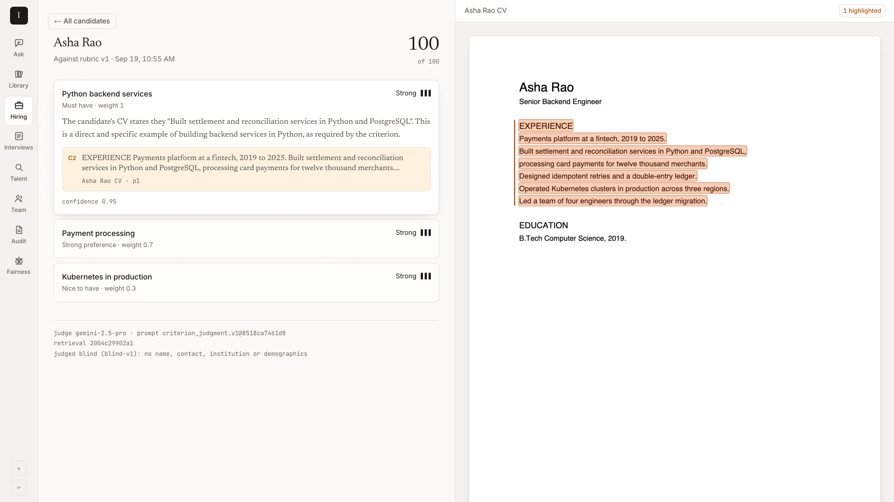

# InsightLM

**Evidence-grounded document intelligence, applied to hiring.**

AI screening tools are distrusted, and increasingly regulated, because they can't show
their work. InsightLM is built the other way round: **no AI claim is shown without a
citation to the exact passage that supports it**, a model never produces a score, and a
person approves the criteria before anyone is assessed against them.

MCA final-year project: a working system, and a dissertation built on measurements of it.



---

## What it does

- **Ask your documents.** Upload PDFs, DOCX or text; ask questions; every sentence of the
  answer links to a highlighted span in the original. It refuses when the documents
  don't support an answer.
- **Assess candidates against a human-approved rubric.** Each criterion is judged
  separately on evidence retrieved from that candidate's own CV. Every verdict cites the
  passage it rests on, and the score is plain arithmetic over those verdicts
  (ADR-0010, ADR-0011). A missing must-have flags the application for a person; nobody is
  rejected automatically.
- **Run a hiring pipeline as a team.** Roles, invitations, stage gates (no offer without
  two scorecards), interview panels whose members can't see each other's ratings until
  they've submitted their own, rejection reason codes, talent-pool search.
- **Govern it.** A hash-chained, append-only audit log; blind screening (the judge never
  sees name, contact details, institution or demographics); a counterfactual fairness
  harness; a four-fifths selection-rate report from voluntary self-identification;
  erasure that searches every store afterwards to prove nothing identifying is left.
- **Review contracts, on the same engine.** Counsel approve a playbook of clause
  positions; each contract is checked clause by clause, every finding cited, critical gaps
  sent to counsel. Built as a second vertical without changing the engine (ADR-0022).
- **Defend it.** CVs are written by the people being judged. Hidden text (white-on-white,
  1pt, transparent, off-page) is kept out of the index and shown to reviewers; prompt
  sources are escaped so a CV can't forge instructions (ADR-0012).

## What the measurements say

All from synthetic data with known ground truth (ADR-0018); every number is reproducible
from `eval/results/` and the harnesses in `src/insightlm/cli/`.

| Question | Result | Where |
| --- | --- | --- |
| Which retrieval? | Dense + contextual enrichment: nDCG 1.00. Hybrid RRF *hurt* (0.80) once phrasing varied | Findings 4–11, ADR-0007 |
| Is a model judge worth paying for? | 95% on 37 labelled cases vs 43% for a term-overlap baseline (11% vs 89% on negation) | Findings 12, 19 |
| Does hidden text change scores? | Undefended, a hidden claim lifts a designer from 0 to 76 (mean +27); defended, +0 | Findings 14–15 |
| Does the candidate's name, college or city move scores? | Nothing significant after correction. Closest: a regional college ~9 points lower unblinded (p = 0.05), gone with blind screening (p = 0.82) | Findings 17, 21 |
| Does the shortlist rank people correctly? | 50 CVs of known strength: Spearman ρ 0.86 with the free baseline judge | docs/05, Phase 4 |
| Does it hold up? | 50 users: p95 58 ms, 0 errors. 200 users: one process saturates; four take p95 1.73 s → 115 ms | docs/09 |

Several of the most useful findings were **negative or corrected**: a fusion result that
was really a bug, a "bias" that was one lucky sample, a prompt fix that single runs
couldn't validate, a noise reduction that didn't replicate. They're reported as such.

## Run it

Needs Docker. One command, no keys:

```bash
make up                  # postgres+pgvector, redis, minio, api, worker, web, tempo, grafana
open http://localhost:3000
```

Without a model key everything runs on offline adapters (extractive answers, a
term-overlap judge, hashing embeddings), labelled as such in the UI. For real answers
and judgments, put `GEMINI_API_KEY=...` (or `ANTHROPIC_API_KEY`) in `.env` and
`make up` again. See `.env.example`.

**A demo workspace** with four people, 33 CVs, an approved rubric and a pipeline in motion:

```bash
make samples                                   # sample and attacked CVs into ./samples
uv run python scripts/seed_demo.py             # sign in as ravi@acme-demo.example
```

Password for every demo account: `demo-password-change-me`. Owner `priya@`, recruiter
`ravi@`, hiring manager `lena@`, interviewer `ada@` (all `@acme-demo.example`).

| | |
| --- | --- |
| App | http://localhost:3000 |
| API + OpenAPI docs | http://localhost:8000/docs |
| Grafana (dashboard + traces) | http://localhost:3001 |

## Check it

```bash
make check          # ruff, mypy --strict, import-linter (9 architecture contracts)
make test           # 393 tests; real Postgres via testcontainers
make coverage       # 89%, fails under 85% (as CI does)
make eval-gate      # retrieval regression gate, offline, deterministic
make eval-injection # red team: detection, false positives, effect on scores
make eval-judge     # judge benchmark (JUDGE=gemini for the model; cached)
make fuzz           # schemathesis against the running API
make load           # k6, 50 users, SLO thresholds
make a11y           # axe-core WCAG 2.1 AA on every page
```

CI runs the checks, the tests with a coverage floor, migration drift, the retrieval
gate, pip-audit, gitleaks and Trivy, all without a model key.

## How it's built

One Python service, hexagonal inside (`domain / ports / application / adapters` per
module), with module boundaries enforced by `import-linter`: recruiting reaches
retrieval only through `EvidencePort`. Postgres 17 with pgvector for rows and vectors,
row-level security per workspace under a restricted database role, a transactional
outbox to an ARQ worker, Redis for the queue and every limit, MinIO/S3 for files.
Next.js 16 frontend behind a same-origin proxy. OpenTelemetry traces follow a CV from
upload through the queue to the model call.

**Python 3.12 · FastAPI · Pydantic v2 · SQLAlchemy 2 (async) · Alembic · ARQ · Postgres 17 + pgvector · Redis · MinIO · Next.js 16 · React 19 · Tailwind 4 · OpenTelemetry · Tempo · Prometheus · Grafana**

Diagrams: [docs/11-diagrams.md](docs/11-diagrams.md). Kubernetes manifests: `deploy/k8s`.

## Documentation

| | |
| --- | --- |
| [01 Charter and scope](docs/01-charter-and-scope.md) | The problem, research questions, success criteria |
| [02 Architecture](docs/02-architecture.md) | Structure, modules, data model, request flows |
| [03 AI engineering](docs/03-ai-engineering.md) | Ingestion, retrieval, the citation contract, safety |
| [04 Recruiting and governance](docs/04-recruiting-and-governance.md) | Domain rules, roles, fairness, candidate rights |
| [05 Delivery plan](docs/05-delivery-plan.md) | Phases, what each delivered, what was carried forward |
| [06 Engineering standards](docs/06-engineering-standards.md) | Testing, CI, definition of done |
| [07 Evaluation findings](docs/07-evaluation-findings.md) | **The results: Findings 1–24** |
| [08 Threat model](docs/08-threat-model.md) | STRIDE, each control pointing at its test |
| [09 SLOs and capacity](docs/09-slos-and-capacity.md) | Objectives, load tests, the bottleneck |
| [10 Runbook](docs/10-runbook.md) | Deploy, trace a request, one section per symptom |
| [11 Diagrams](docs/11-diagrams.md) | C4 context, containers, components; generated ER diagram |
| [ADRs](docs/adr/README.md) | 22 decision records, including where the plan was wrong |

## Limits, stated

Synthetic data only, so external validity is untested. Scanned CVs skip the
hidden-text defence until OCR exists. Paraphrased instructions evade the pattern scan
(harmless in the measured cases, but unflagged). The PDF viewer is desktop-only. Details in docs/08 and docs/05.
