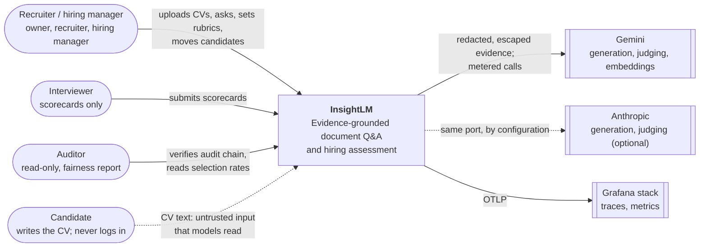
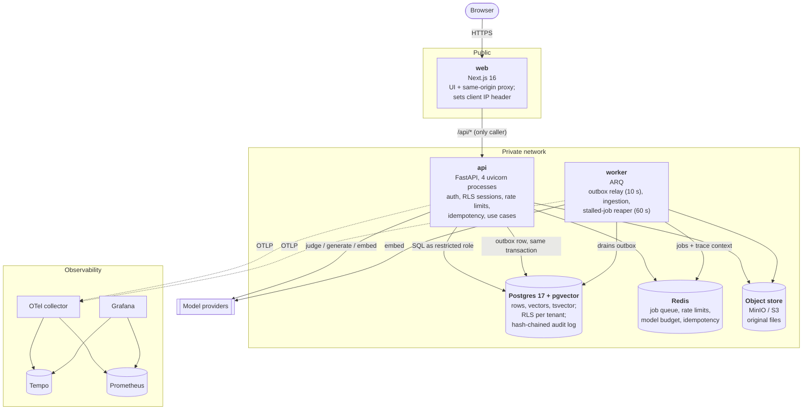
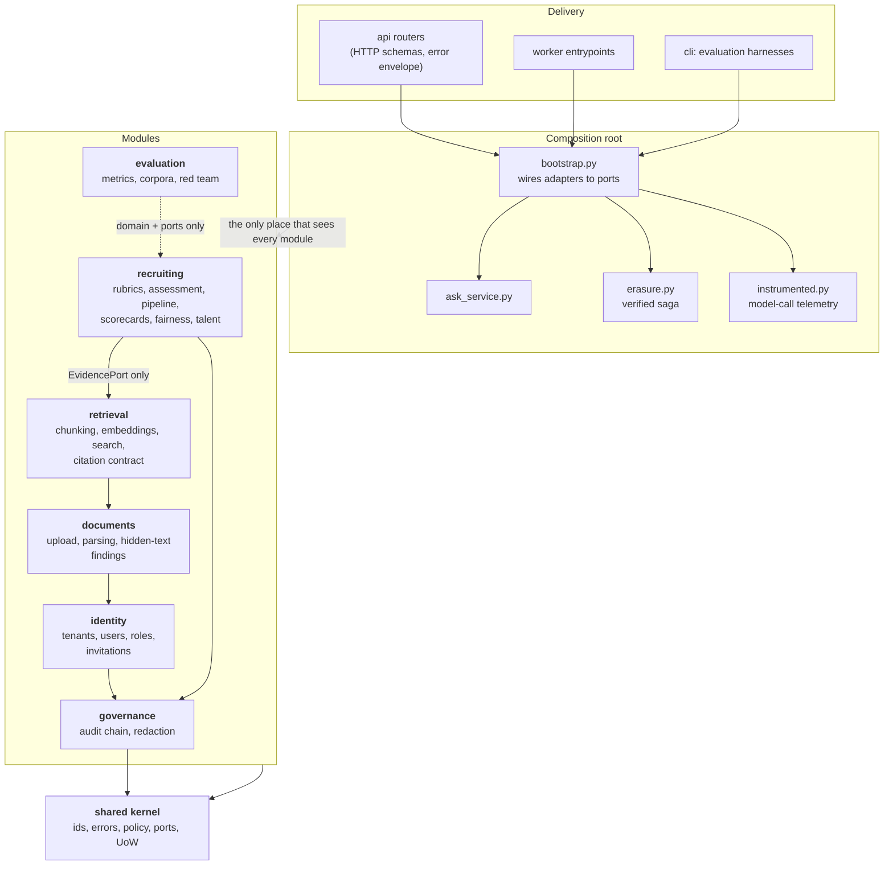

# 11 — Diagrams

C4 views of the system, and the data model. Sources are in `docs/diagrams/*.mmd`
(Mermaid, rendered by GitHub); SVGs for the dissertation are built with `make diagrams`.
The ER diagram is **generated from the SQLAlchemy models** (`scripts/er_diagram.py`),
so it can't drift from the schema.

## Context

Who uses InsightLM and what it depends on. The dotted line from the candidate is the
design's central risk: the people being evaluated write the input the models read
(ADR-0012).

## Containers

What runs, and who may talk to whom. Only the web tier is public; the API is reachable
only from it (enforced by `deploy/k8s/networkpolicy.yaml`), which is what makes its
client-IP header trustworthy. Every limit and counter lives in Redis, so API processes
share no state and scale horizontally (docs/09).

## Components

Modules and the one direction their dependencies may point, enforced by
`import-linter` in CI (nine contracts, `.importlinter`). `recruiting` sees retrieval only
through `EvidencePort`; nothing reaches another module's adapters or application layer;
the composition root is the only place that knows every module.

## Data model

Generated. Every tenant-scoped table carries `tenant_id` and a row-level security policy
keyed on it; `audit_entries` is append-only for the application role.

```mermaid
erDiagram
    answers {
        UUID id PK
        UUID tenant_id
    }
    applications {
        UUID id PK
        UUID tenant_id
        UUID candidate_id FK
        UUID requisition_id FK
        string stage
    }
    assessments {
        UUID id PK
        UUID tenant_id
        UUID application_id FK
        UUID rubric_id FK
    }
    audit_entries {
        UUID id PK
        UUID tenant_id
    }
    candidates {
        UUID id PK
        UUID tenant_id
    }
    chunks {
        UUID id PK
        UUID tenant_id
        UUID document_version_id FK
        VECTOR embedding
    }
    dead_letters {
        UUID id PK
        UUID tenant_id
    }
    document_texts {
        UUID document_version_id PK,FK
        UUID tenant_id
    }
    document_versions {
        UUID id PK
        UUID document_id FK
        UUID tenant_id
        string status
    }
    documents {
        UUID id PK
        UUID tenant_id
    }
    ingestion_jobs {
        UUID id PK
        UUID tenant_id
        UUID document_version_id FK
        string status
    }
    invitations {
        UUID id PK
        UUID tenant_id FK
        UUID invited_by FK
        UUID accepted_by FK
    }
    memberships {
        UUID id PK
        UUID tenant_id FK
        UUID user_id FK
    }
    model_versions {
        UUID id PK
    }
    outbox_events {
        UUID id PK
        UUID tenant_id
    }
    prompt_templates {
        UUID id PK
    }
    prompt_versions {
        UUID id PK
        UUID template_id FK
    }
    requisitions {
        UUID id PK
        UUID tenant_id
        string status
    }
    rubrics {
        UUID id PK
        UUID tenant_id
        UUID requisition_id FK
        string status
    }
    scorecards {
        UUID id PK
        UUID tenant_id
        UUID application_id FK
        UUID requisition_id FK
    }
    self_identifications {
        UUID candidate_id PK,FK
        string dimension PK
        UUID tenant_id
    }
    stage_transitions {
        UUID id PK
        UUID tenant_id
        UUID application_id FK
    }
    tenants {
        UUID id PK
    }
    users {
        UUID id PK
    }
    candidates ||--o{ applications : "candidate_id"
    requisitions ||--o{ applications : "requisition_id"
    applications ||--o{ assessments : "application_id"
    rubrics ||--o{ assessments : "rubric_id"
    document_versions ||--o{ chunks : "document_version_id"
    document_versions ||--o{ document_texts : "document_version_id"
    documents ||--o{ document_versions : "document_id"
    document_versions ||--o{ ingestion_jobs : "document_version_id"
    tenants ||--o{ invitations : "tenant_id"
    users ||--o{ invitations : "invited_by"
    users ||--o{ invitations : "accepted_by"
    users ||--o{ memberships : "user_id"
    tenants ||--o{ memberships : "tenant_id"
    prompt_templates ||--o{ prompt_versions : "template_id"
    requisitions ||--o{ rubrics : "requisition_id"
    applications ||--o{ scorecards : "application_id"
    requisitions ||--o{ scorecards : "requisition_id"
    candidates ||--o{ self_identifications : "candidate_id"
    applications ||--o{ stage_transitions : "application_id"
```

